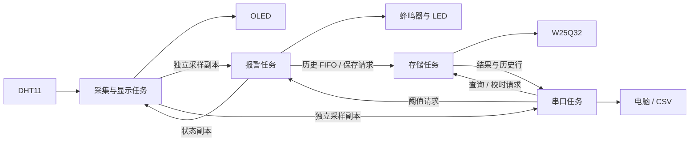

# STM32 FreeRTOS EnvLogger

**基于 STM32 与 FreeRTOS 的环境监测及持久化数据记录系统**

基于 STM32F103C8T6，完成 DHT11 温湿度采集、OLED 显示、声光报警、参数掉电保存及历史数据查询导出。采用原生 FreeRTOS，将采集显示、报警、串口和存储分为四个任务。

**状态：已完成主要功能及部分实物验证。** 已有 1136 条记录的完整 CSV 导出样例。具体证据和未覆盖的场景见 [验证记录](docs/verification.md)。

## 功能与设计亮点

- 本地按键消音、电位器调节阈值，串口查询和配置；报警包含触发/解除回差。
- 使用队列传递状态副本与请求；存储任务统一访问 W25Q32，8 条历史 FIFO 分离报警处理与 Flash 操作。
- 参数 A/B 双副本、序号、CRC 和提交标记，减少写入中断造成有效参数丢失的风险；相同参数跳过擦写。
- 外部 Flash 环形历史记录、内部 RTC 校时、同一次启动内校时前记录的时间推算。
- 序号游标分页、可取消的 CSV 导出、导出期间命令隔离、二次确认的历史逻辑清空。
- FreeRTOS 堆与任务栈余量查询。

## 技术与硬件

C · STM32 HAL · 原生 FreeRTOS · GPIO · 软件 I²C · UART 中断接收 · SPI NOR Flash · ADC · 内部 RTC · Python

硬件：STM32F103C8T6、DHT11、I²C OLED、W25Q32、LED、有源蜂鸣器、按键、电位器、USB-TTL。

接线及供电说明见 [hardware.md](docs/hardware.md)。

## 软件结构



任务职责、优先级及数据流见 [architecture.md](docs/architecture.md)。

## 编译和运行

1. 安装 Keil MDK，启用 ARM Compiler 5，并安装 STM32F1xx 设备支持包。原工程记录的编译器为 5.06 update 7、设备包为 2.4.0。
2. 安装 Python 3.10+，用于构建前的工程配置一致性检查。若系统找不到 Python，可将环境变量 `STM32_PYTHON` 设置为真实 `python.exe` 的完整路径，并重新打开 Keil。
3. 打开 `MDK-ARM/F103_FreeRTOS_CubeMX.uvprojx`，执行 Rebuild，使用 ST-Link/SWD 下载。
4. 按接线文档连接硬件；USB-TTL 使用 3.3V 逻辑，串口设置 **115200、8N1、无流控**。
5. 发送 `help` 查看命令，发送 `diag` 查看资源余量。每次启动后需要重新校时。

仓库名与内部工程名不同，保留原工程名以维持相对路径。直接打开工程即可；重新使用 CubeMX 生成代码时，请先阅读 [配置维护](docs/build-and-maintenance.md)。

## 电脑校时和导出

在仓库根目录打开终端，安装串口依赖：

```powershell
python -m pip install -r requirements.txt
python Tools/sync_pc_time.py --port COM7
python Tools/export_history.py --port COM7 --output history.csv
```

`COM7` 为示例，请替换成实际端口。运行工具前关闭占用串口的串口助手。校时使用电脑提供的北京时间，日期格式为 `YYYY MM DD HH:MM:SS`。

实测样例见 [samples/history_export_20261020.csv](samples/history_export_20261020.csv)，命令说明见 [commands.md](docs/commands.md)。

## 验证与边界

- 既有板上记录：1136 条 CSV，跳过 0 条，结束状态 OK；导出取消、普通查询隔离、历史清空及参数保留已有记录。
- 复位、普通断电后参数和历史清空状态保留由操作反馈确认；未执行指定写入阶段的精确断电注入。
- 完整满环覆盖、长期稳定性、RTC 长期走时和导出负载下的最坏报警响应尚未专项实测。
- RAM 队列中的待写记录会随断电丢失；当前版本未启用 DMA、RS485 或 Modbus。

本次仓库整理不产生新的硬件测试结论。照片与实物视频尚待补充。

## 仓库目录

```text
Core/             应用、服务与设备驱动
Drivers/          STM32 HAL / CMSIS
Middlewares/      FreeRTOS
MDK-ARM/          Keil 工程与启动文件
Tools/            校时、导出及配置同步工具
Tests/            既有主机与模型验证代码
docs/             接线、架构、命令与验证说明
samples/          已有 CSV 样例与原始实测元数据
F103_FreeRTOS_CubeMX.ioc
```

## 许可与来源

新增原创应用代码和仓库文档的许可范围见 [LICENSE](LICENSE)。ST、ARM、FreeRTOS 等第三方内容保留各自许可及版权，见 [THIRD_PARTY_NOTICES.md](THIRD_PARTY_NOTICES.md)。
